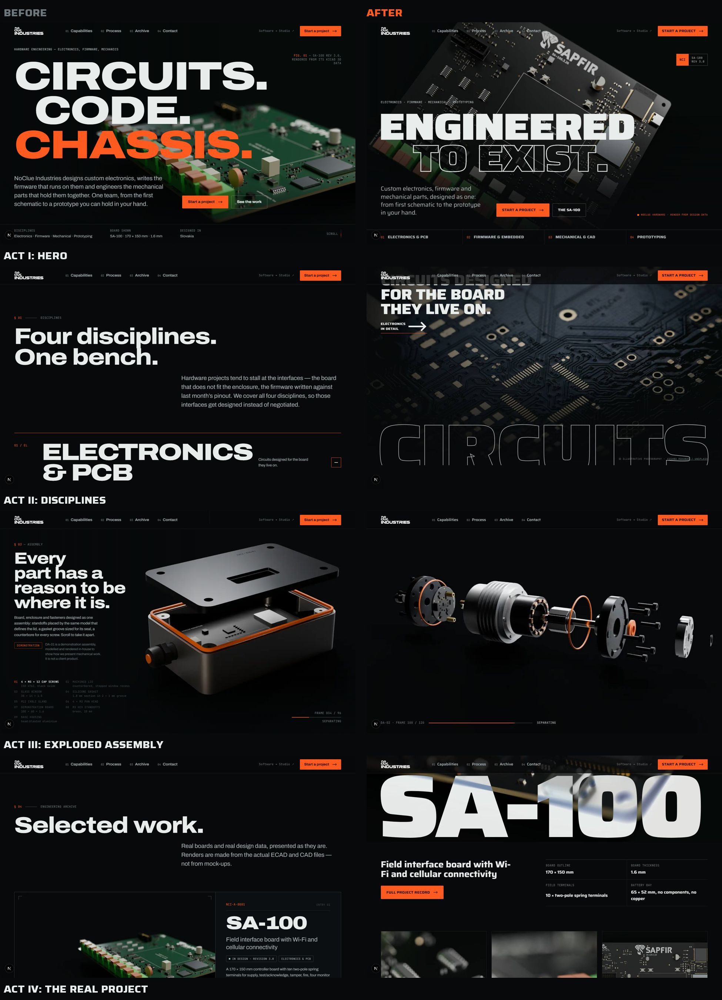

# Creative direction: redesign v2

## The idea

The site presents NoClue Industries as **a real, premium hardware engineering corporation that
operates a few decades ahead of us**. It is a company site, not a cyberpunk-themed site: there is
no neon, no glitch, no fake terminal and no HUD clutter. The futurism comes from **scale,
material, light and confidence**. Short, heavy statements sit on full-bleed imagery, the hardware
is lit like product advertising, and there is a lot of controlled black.

The first version was clean but read like a consultancy brochure: text-led, built from repeated
heading + paragraph + rows sections, with one green-board render doing all the visual work.
Version 2 changes the balance. The visuals say what we do before anyone reads anything, and the
long explanations move to `/capabilities`.

**Rule that does not bend:** atmosphere may be borrowed, credibility may not. Licensed
photographs set the scene; our own renders prove the work. Every image says which it is.

## Homepage: five acts

Each act uses a different composition. The page should have rhythm, not repetition.

| Act | Composition | Imagery | Copy |
|---|---|---|---|
| **I · Hero** | Full-bleed render; two-line display headline (solid + outline) over the board; one-sentence lede; a discipline index bar along the bottom edge | SA-100, plan view, raking light (real) | "Engineered / to exist." + 1 sentence |
| **II · Engineering** | Four chapters, each different (below) | 5 licensed photos + 2 real renders | One headline per discipline |
| ↳ 01 Electronics | Full-bleed photo; outlined CIRCUITS cropped at the bottom edge; then **the cut** to a split showing our own SA-100 maker's mark ("And this one is ours") | PCB macro (photo) → SA-100 mark (real) | |
| ↳ 02 Firmware | Asymmetric: big statement left; tall photo bleeding off the right edge; the real ESP32-S3 render inset below it | PCB with crystal (photo) + SA-100 corner (real) | "Code that knows the pinout." + capability chips |
| ↳ 03 Mechanical | Full-bleed band with METAL in difference blend; then an off-grid diptych (wide + tall) | Gearbox cutaway, end mill, face mill (photos) | One statement |
| ↳ 04 Prototyping | **The only full signal-orange field.** Heavy black type; an honest two-column split, "We deliver" vs "Made by manufacturing partners", generated from the services data; angled-mask photo | Laser sparks, orange duotone (photo) | "From file to part." |
| **III · Assembly** | Pinned full-viewport canvas, 120 frames scrubbed by scroll; intro text fades out as the parts separate; leader-line callouts on the exploded state; the sequence completes at 86% of the pin so the labelled state holds | DA-02 (demonstration) | "Take it apart." + 1 line |
| **IV · Actual engineering** | 21:9 product shot with SA-100 set at 25vw in difference blend; subtitle, CTA, facts; three portrait close-ups | SA-100 renders only | From the CMS project |
| **V · Invitation** | Display question; one primary action plus the email; B/W photo on the right | Machined ring (photo) | "Have something to build?" |

The homepage's visible explanatory copy dropped from about 330 words of paragraphs to about 90.
The process sheet and the "why one team" points now live on `/capabilities`.

## Typography

**Saira** (SIL OFL, variable: wght 100–900, wdth 50–125) replaces Archivo. At width 125 and
weight 880–900 its squared, rounded-corner letterforms belong to the same family of shapes as the
**INDUSTRIES** lettering in the supplied logo. Archivo was a neutral grotesque; Saira gives the
brand a voice. One family covers everything:

- **Display:** wdth 125, wght 900, tracking −0.03 to −0.045 em, line-height 0.76–0.86, uppercase. Sized in vw
  so hero lines span the container at every breakpoint.
- **Outline display** (`.display--outline` / text-stroke) is used only for the second hero line
  and the cropped CIRCUITS. It reads like an engraved plate. Checked at full size for
  contour-overlap seams; none show.
- **Headings / UI:** wdth 110–125, wght 700–880. Buttons are uppercase and expanded.
- **Body:** wdth 100, wght 400.
- **JetBrains Mono:** part numbers, provenance tags, frame counters.

Both fonts are self-hosted (latin + latin-ext for the Slovak operator data), and Saira is preloaded.

## Colour

Unchanged palette, used more boldly.

| Token | Value | Use |
|---|---|---|
| `--void` | `#07090A` | page; renders and photos are graded to meet exactly this colour |
| `--signal` | `#FF5A1F` | CTAs, indices, callout dots, **one full-orange section per page at most** (`.on-signal`) |
| `--fg` … `--fg-4` | cool white → steel | hierarchy |
| `--sheet` | `#E6E9E6` | the light drawing sheet (Process, on `/capabilities`) |

The orange still comes from the hardware: the SA-100 terminal levers, and the seals and O-rings of
DA-02.

## Photography

Ten photographs, licensed under the Unsplash License. Sources, photographers, licence check and
placements are in [`website-assets/photography/MANIFEST.md`](../website-assets/photography/MANIFEST.md),
and credits are public at `/credits`.

**Selection rule:** they must look extraordinary, not just relevant. Each one has dramatic
directional light, metal or copper detail, shallow depth of field, and room for type.

**One house grade** (`visualization/scripts/grade_photos.py`) makes ten photographers read as one
campaign:

- **Cold steel:** partial desaturation; crushed blacks that meet `--void`; cool shadows and
  neutral highlights; a gentle S-curve; edge falloff into the page colour; fine grain.
- **Mono:** two images (ring, steel balls).
- **Signal duotone:** one image (laser sparks) for the orange field.

**Honesty rules:**

- Photos are always labelled "Illustrative photography · Photographer / Unsplash".
- They are never captioned as our equipment, our premises or our work.
- They always precede, never replace, a real render.
- Crops remove the maker's marks; no identifiable people appear.

## Renders

- **SA-100 is black.** The board's soldermask is black and its silkscreen white. The KiCad glTF
  export carries a default green, which the first version rendered. The fix is in the material
  layer (`visualization/configs/sa100.py` → `BOARD_COLORS`, `Library.soldermask(finish="satin")`):
  a black LPI mask under a semi-gloss clear coat, so strip lights and grazing highlights trace the
  copper relief and the board stays legible on near-black. Component colours (green terminal
  bodies, orange levers, ENIG pads) are untouched. Geometry is unaltered.
- **New campaign shots:** `plan_raking` (hero), `cine_corner` (ESP32-S3 + USB-C macro) and
  `macro_mark` (the silkscreen maker's mark), with new `rig_cinematic`, `rig_raking` and
  `rig_technical_black` lighting.
- **Versioning:** all renders moved to `/renders/v2`. The green SA-100 files were removed from v1,
  so no cache or old URL can serve them.

## DA-02: the exploded assembly

DA-01 (a box with a lid) was honest but not spectacular: seven parts on one axis, filling a third
of the frame. It is replaced on the site by **DA-02, a sealed BLDC actuator module**, an original
demonstration concept where bearings, a shaft and many aligned layers are mechanically natural:

- **Front:** machined output flange and circlip, shaft lip seal, anodised front cover with
  6 × M4 cap screws, 22/8/7 deep-groove bearing, O-ring.
- **Core:** a finned bead-blasted housing with a bearing bulkhead, a 12-slot wound stator, and a
  10-pole magnet rotor on a Ø8 stainless shaft.
- **Rear:** bearing, encoder magnet, round driver PCB on brass standoffs (black mask, white
  "DA-02 DEMONSTRATION" silkscreen), O-ring, rear cap with 6 × M3, M8 connector.

Everything separates along the shaft axis, front parts forward and rear parts back, outermost first.
Screws spin out. The camera opens close on the sealed module and pulls back as it comes apart.
The sequence is 120 frames at 1920/1280/720 px (3.4 / 2.1 / 1.0 MB). DA-01's script, scenes and
outputs remain in the pipeline.

The model is always labelled "Demonstration model · not a product", and the disclaimer stays in
the CMS.

## Provenance system

`<Prov>` renders one of three tags, and every image on the site carries one:

- ■ **NoClue hardware · render from design data** (filled orange square)
- ◩ **Demonstration model · not a product**
- □ **Illustrative photography · Name / Unsplash** (links to the source)

## Motion

- **Hero:** the board emerges from darkness with a slight rotation, then drifts away on scroll.
- **Headlines:** lines rise out of a mask.
- **Photos:** a slow zoom tied to their view timeline.
- **SA-100 stage:** pushes in from dark.
- **Assembly:** scrubbed by scroll. Callout leader lines draw themselves in.
- **Reduced motion:** no animation at all. The assembly becomes three stills plus a complete part list.
- **Scroll-driven CSS** (`animation-timeline`) is feature-detected; without it, the page is simply static.

## Responsive

- **Mobile:** hero type scales with vw; the discipline index wraps to 2 × 2; chapters stack;
  photos bleed to the screen edge; provenance tags move to the top of full-bleed bands.
- **Assembly on mobile:** fits the frame to the width (zoom 1.22), because the assembly runs
  horizontally.
- **Overflow:** verified at 390 and 1440 px.

## Screenshots

`docs/redesign/`: `before-after.jpg`, `after-hero.jpg`, `after-firmware.jpg`,
`after-prototyping.jpg`, `after-assembly.jpg`, `after-mobile.jpg` (a 15-frame tour at 390 × 844).
